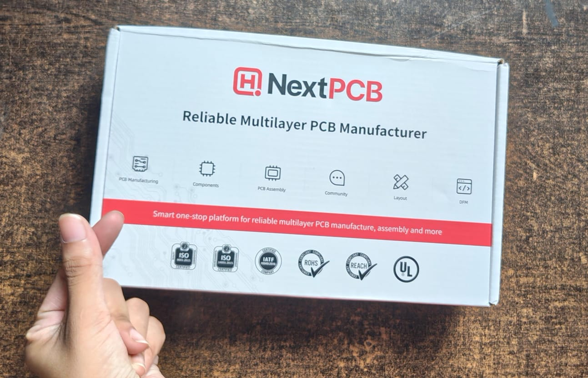
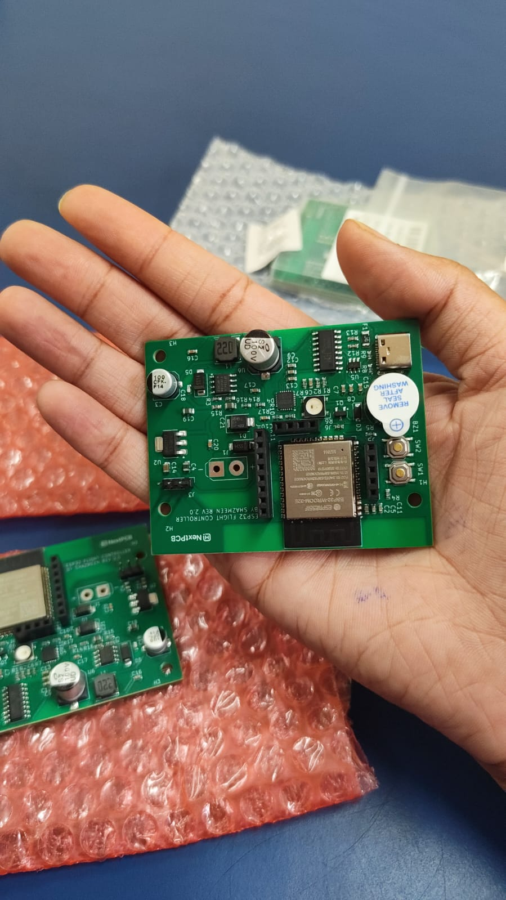
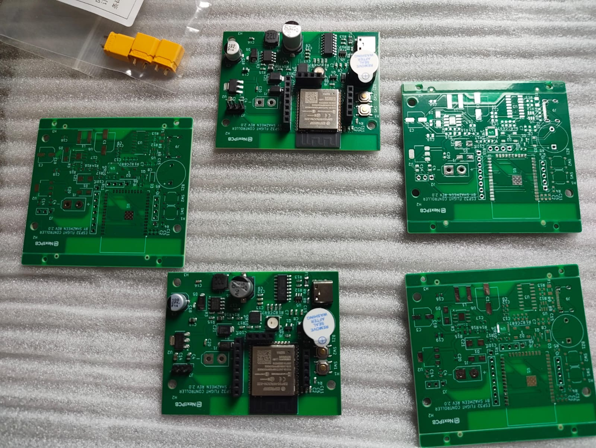
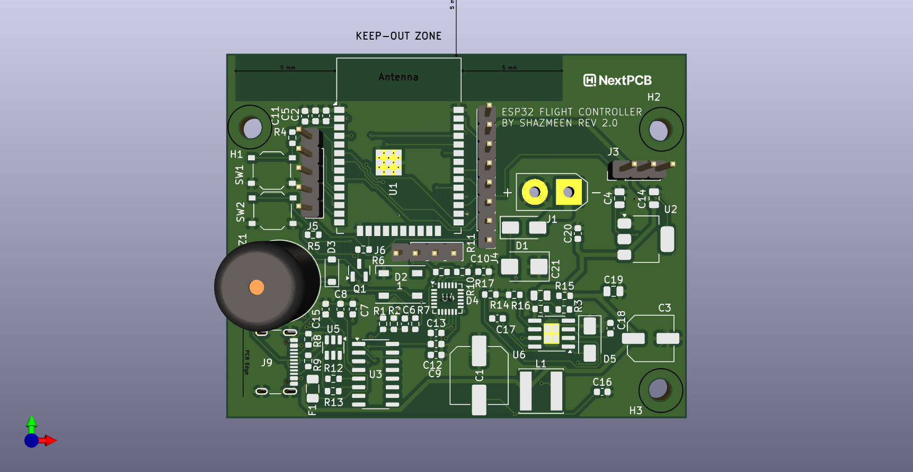
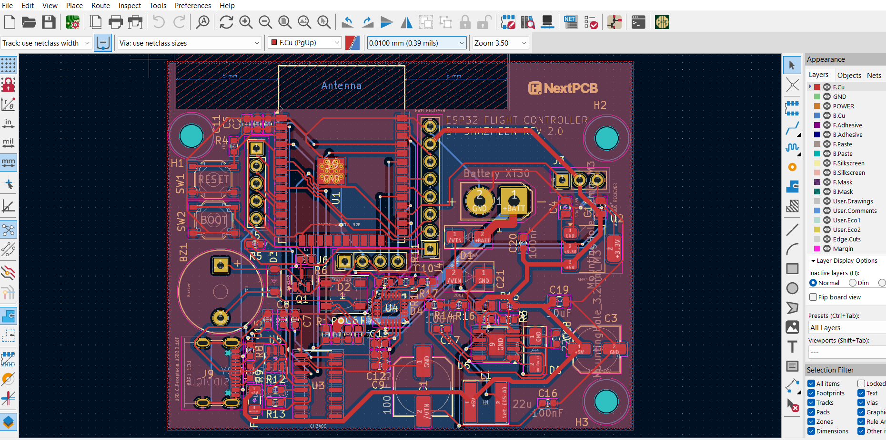
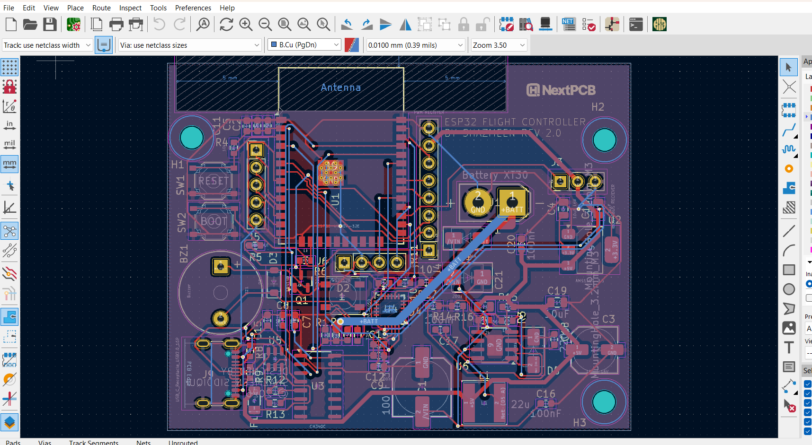
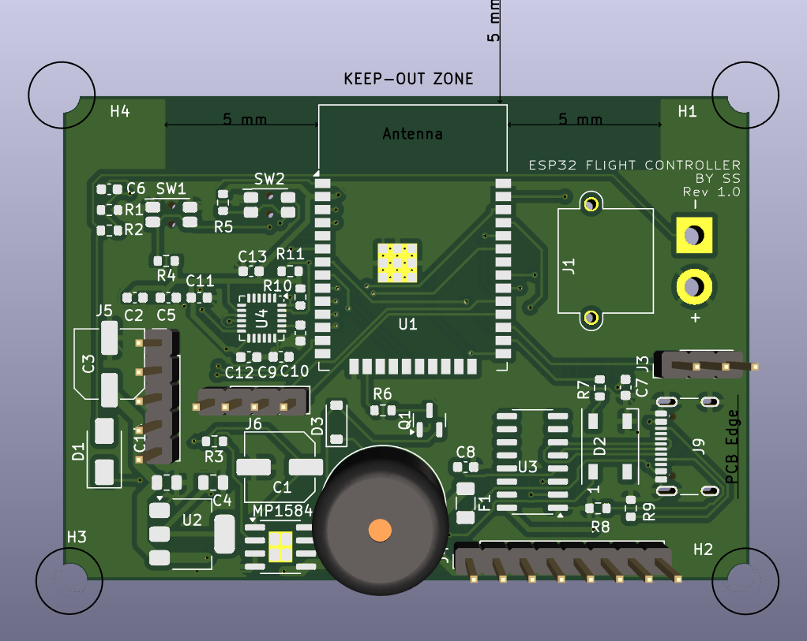
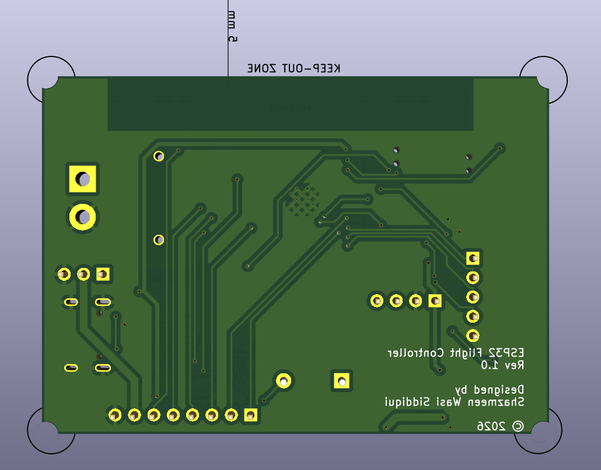
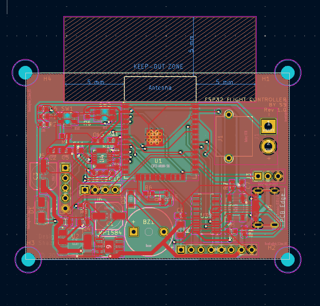
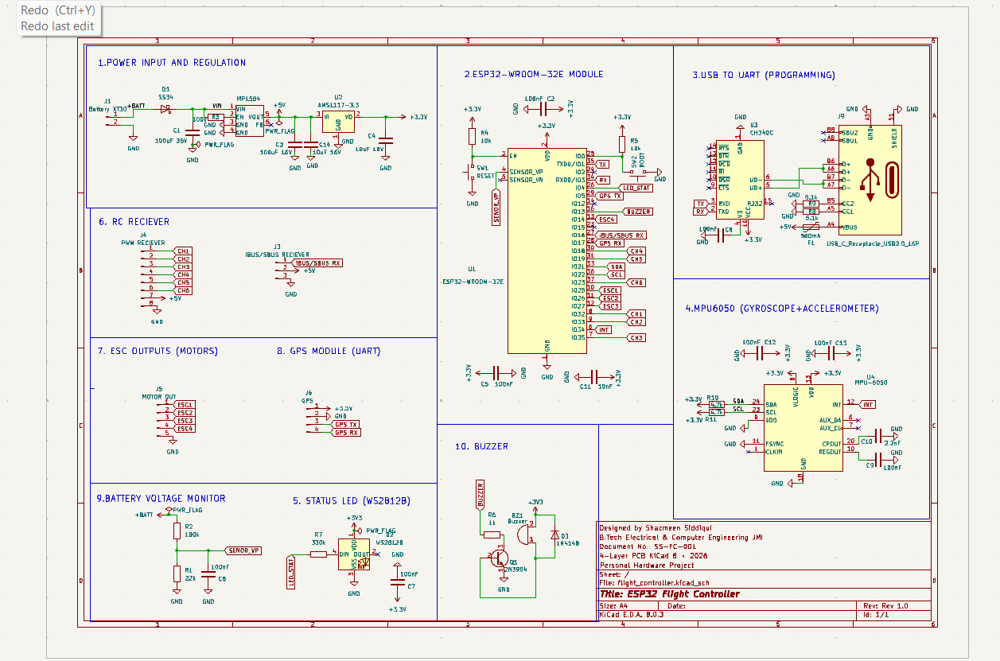

# ESP32 Flight Controller

A 4-layer ESP32 flight-controller PCB, designed in KiCad 8 and manufactured as Rev 2.


<p align="center">
  
</p>

The board is built around an **ESP32-WROOM-32E**. It takes a LiPo on an XT30, makes 5 V with an MP1584 and 3.3 V with an AMS1117, and brings out USB-C programming, an MPU-6050, GPS, and receiver headers. This repository is the hardware: schematics, PCB, Gerbers, BOM, and photos. There is no flight firmware here.

---

## Hardware

| | |
| --- | --- |
| MCU | ESP32-WROOM-32E (Wi-Fi and Bluetooth) |
| IMU | MPU-6050, I²C |
| USB | Type-C, CH340C USB-UART |
| Battery | LiPo on XT30 (J1) |
| 5 V | MP1584 buck (U6) |
| 3.3 V | AMS1117-3.3 (U2) |
| Status | WS2812B and an active buzzer |
| Buttons | BOOT (SW2) and RESET (SW1) |
| Board | 4-layer, 1.6 mm |
| CAD | KiCad 8 |

Power path:

```text
LiPo (XT30) → MP1584 → 5 V → AMS1117-3.3 → 3.3 V → ESP32
```

Copper is 1 oz (0.035 mm) on all four layers. The Rev 2 Gerbers name the inner layers `GND` and `POWER`.

### Connectors

| Ref | What it is |
| --- | --- |
| J1 | Battery, XT30 |
| J3 | iBUS / SBUS receiver, 1×3 |
| J4 | PWM receiver, 1×8 |
| J5 | Motor outputs, 1×5 |
| J6 | GPS UART, 1×4 |
| J9 | USB-C |
| — | ADC battery-voltage divider |

---

## Revisions

**Rev 1** is the first design, in the repository root (`flight_controller.kicad_sch`, `flight_controller.kicad_pcb`, `flight_controller_BOM.csv`, and `ESP32-FLight-Controller-Gerber.zip`).

**Rev 2** is the board that was manufactured. Files are under `Rev2/`. Compared with the Rev 1 BOM, Rev 2 adds:

- USBLC6-2SC6 (U5) on USB
- SM6T24A (D4) and a second Schottky (D5)
- the NextPCB logo footprint on the PCB

---

## Rev 2 photos

<p align="center">
  
  
</p>

<p align="center">
  
  
</p>

KiCad renders and copper views:

<p align="center">
  
  
</p>

<p align="center">
  
  
</p>

### Rev 1 views

<p align="center">
  
  
</p>

<p align="center">
  
</p>

<p align="center">
  
</p>

---

## What is in this repo

```text
ESP32-Flight-Controller
├── flight_controller.kicad_pro      Rev 1 KiCad project
├── flight_controller.kicad_sch
├── flight_controller.kicad_pcb
├── flight_controller_BOM.csv
├── ESP32-FLight-Controller-Gerber.zip
├── pcb.png
├── schematic.png
├── 3D_front.png
├── 3D_back.png
├── LICENSE
├── README.md
└── Rev2/
    ├── KiCad/                       schematic, PCB, NextPCB logo footprint
    ├── Gerbers/                     copper, mask, paste, silk, edge, drill
    ├── BOM/flight_controller_bom.csv
    ├── Documentation/               drill map
    └── Images/                      photos, renders, copper plots, logo
```

Open `Rev2/KiCad/flight_controller_rev2.kicad_pro` in KiCad 8. The Gerber set in `Rev2/Gerbers/` is what was sent for manufacturing.

---

## Manufacturing support

<p align="center">
  <a href="https://www.nextpcb.com">
    
  </a>
</p>

Thank you to [NextPCB](https://www.nextpcb.com) for manufacturing the Rev 2 PCB. That support took the design from KiCad to a finished board and made the hands-on testing of this student project possible.

**Manufacturing partner:** [NextPCB](https://www.nextpcb.com)  
**Sponsored revision:** Rev 2

---

## Not on this board yet

These are next hardware steps, not features of the current PCB:

- Barometer (BMP280 / BME280)
- Magnetometer
- Current sensor
- Blackbox logging
- CAN
- Stronger input protection beyond the parts already on Rev 2

---

## Author

**Shazmeen Siddiqui**

B.Tech, Electrical and Computer Engineering, Jamia Millia Islamia

## License

[MIT](LICENSE)
